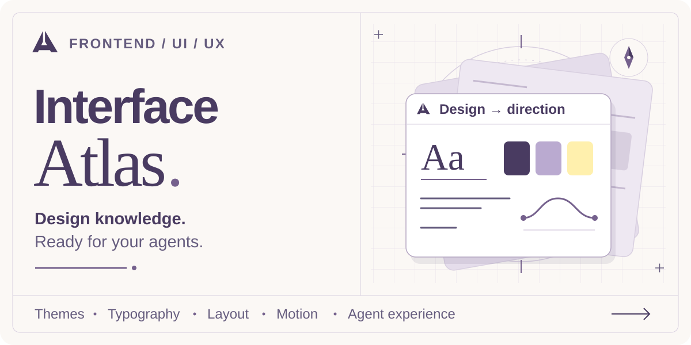

<picture>
  <source media="(prefers-color-scheme: dark)" srcset="assets/brand/hero-dark.svg">
  
</picture>

# Interface Atlas

A frontend UI/UX knowledge library for preparing project-specific design documents and implementing focused frontend changes.

[Live previews](https://tamir39.github.io/interface-atlas/) · [Explore themes](catalog/themes.json) · [Explore visual styles](styles/README.md) · [Prepare a project design](skills/prepare-frontend-design/SKILL.md) · [Implement frontend UI](skills/implement-frontend-ui/SKILL.md) · [Logo kit](assets/brand/README.md)

Pick a visual direction, resolve the design decisions, and give your agents a self-contained project design.md. Load selected library guidance when preparing or deliberately revising that document. For a bounded frontend change, the implementation skill starts from your project's own rules and code.

**Styling catalog:** [Glassmorphism](styles/glassmorphism/README.md), [Neobrutalism](styles/neobrutalism/README.md), and [Claymorphism](styles/claymorphism/README.md) are optional visual-style entries beside the nine themes. Explore their [live labs](https://tamir39.github.io/interface-atlas/#styles) and [composition guidance](knowledge/theme-style-composition.md). The [Claymorphism trial](examples/claymorphism-composition-evaluation/README.md), alongside the earlier style trials, distinguishes bounded render checks from theme fit and explicit geometry overrides. Other researched families remain candidates.

**Current collection:** Editorial, Swiss, Precision, Play, Botanical, Blueprint, Pulse, Gallery, and Layered are the reusable themes. The portfolio and agent operations design examples adapt Editorial; Swiss adds a studio layout and change review; Precision adds a compact operational workspace; Play adds a creative portfolio and project brief builder; Botanical adds a narrative studio and reading room; Blueprint adds an engineering studio and diagram inspector; Pulse adds a bold event program and local schedule planner; Gallery adds an image-led collection and inline inspection with real media recovery; Layered adds a spacious planning workspace with tonal surfaces, native editing, and scoped recovery. All nine theme entries remain drafts. Their validation records describe the browser checks and limits: [Editorial](themes/editorial/validation.md), [Swiss](themes/swiss/validation.md), [Precision](themes/precision/validation.md), [Play](themes/play/validation.md), [Botanical](themes/botanical/validation.md), [Blueprint](themes/blueprint/validation.md), [Pulse](themes/pulse/validation.md), [Gallery](themes/gallery/validation.md), [Layered](themes/layered/validation.md).

## Start here

1. Start with the brief and the project's existing or supplied design direction. When choosing an Atlas theme, read [the theme catalog](catalog/themes.json) to find candidates.
2. For an Atlas candidate, read its README for identity, suitability and limitations. Preserve a project-owned direction or develop a custom one when appropriate.
3. For a requested or unresolved visual style, use [the separate style catalog](catalog/styles.json) and shortlisted READMEs. Load only chosen theme/style rules and the effects, motion and shared knowledge needed for the project.
4. Create a self-contained project design.md with explicit adaptations and source credits.
5. Use that project's documents for normal implementation work. Return to Atlas for deliberate design changes.

See [the preparation skill](skills/prepare-frontend-design/SKILL.md) for this workflow.

## Prepare, implement or review a project

- [Prepare frontend design](skills/prepare-frontend-design/SKILL.md) creates or deliberately revises a self-contained project design.md from a project-owned, supplied, custom or Atlas direction. It routes general UI/UX, accessibility/responsive behavior and applicable state, form, outcome or agent questions through [selected knowledge](knowledge/README.md).
- [Implement frontend UI](skills/implement-frontend-ui/SKILL.md) turns a bounded request into working frontend code, follows the project's stack and design, loads only guidance needed for unresolved decisions, and verifies the changed user path. It can handle a small task without generating design.md. This is an original Atlas workflow, not a discovered upstream skill.
- [Review frontend design](skills/review-frontend-design/SKILL.md) is opt-in. Invoke it explicitly as `$review-frontend-design` where registered, or ask an agent to use that file by path. It reports evidence-backed findings and coverage without implementing fixes. Its Codex metadata disables implicit invocation; actual discovery depends on the consuming host.

The [real frontend implementation trial](examples/implementation-evaluation/README.md) records the new skill adding collection search to the live hub, its selected source reads, browser checks and limits.

These workflows share Atlas resources. Preserve the Atlas directory layout when using repository references; standalone global installations must also retain the shared library and preserve or remap its links. Copying only the three skill folders leaves those references incomplete. Implementation uses the consuming project's documents first; it does not reload the theme library by default. [Method credits and retained licenses](references/skill-adaptations.md) stay separate from [the earlier research proposal](references/skill-research.md).

Use available craft guidance such as `better-ui` selectively alongside the applicable workflow. Explicit user choices and the project's design, accessibility and motion contracts govern conflicting polish defaults. Preparation, implementation and opt-in review remain separate tasks; a small polish change does not require all three.

The [updated skill trials](examples/skill-evaluation/README.md) record generation, explicit review, source-reading scope and remaining evidence limits. The [reference and craft rerun](examples/reference-craft-evaluation/README.md) exercises the A–D additions on the three existing briefs.

Selected guidance now includes [reference evaluation and equivalent-task theme comparison](knowledge/design-reference-evaluation.md), [component mapping](knowledge/ui-ux-design.md#translate-the-design-through-components) and a [chosen-motion contract](knowledge/accessibility-and-responsive.md#record-the-chosen-motion-contract). Load only what resolves a current question. [Practical lessons](references/practical-lessons.md) are optional historical document-trial examples for deliberate research/review; they are outside normal project reading. Framework and format adapters remain deferred.

Git preserves exact bytes for the recorded skill-trial artifacts and retained license files, so their source hashes remain verifiable across platforms.

## Themes and examples

- [Editorial](themes/editorial/README.md): reusable identity, visual rules, optional effects, motion, and provenance.
- [Swiss](themes/swiss/README.md): bold sans typography, aligned composition, flat geometry, optional effects, and separately credited sources.
- [Precision](themes/precision/README.md): productive typography, semantic layers, compact controls, and clear execution, connection, and pending-command states.
- [Play](themes/play/README.md): bold sans typography, rounded pastel surfaces, hard shadows, tactile feedback, and a deliberate brief review flow.
- [Botanical](themes/botanical/README.md): earthy color, serif display, asymmetric corners, soft elevation, and a calm reading/collection flow.
- [Blueprint](themes/blueprint/README.md): cobalt drafting lines, technical typography, modest corners, offset shadows, and a diagram/outline inspection flow.
- [Pulse](themes/pulse/README.md): lime and ink, condensed display type, poster composition, deliberate motion, and a local planning flow with conflict recovery.
- [Gallery](themes/gallery/README.md): image-led composition, quiet sans typography, unboxed media, mixed aspect ratios, and contextual inspection with loading/error recovery.
- [Layered](themes/layered/README.md): spacious application composition, opaque tonal containers, coherent rounded controls, selective dialog elevation, and local task/project editing.
- [Portfolio example](examples/portfolio/design.md): expressive presentation and case-study reading.
- [Agent operations dashboard example](examples/agent-operations-dashboard/design.md): compact layouts and human-agent interaction.
- [Example notes](examples/README.md): assumptions and how to adapt the examples.
- [Live Editorial preview](https://tamir39.github.io/interface-atlas/themes/editorial/preview/): light/dark appearances, density, component specimens, and two sample layouts. [Preview notes](themes/editorial/preview/README.md) explain scope and offline use.
- [Live Swiss preview](https://tamir39.github.io/interface-atlas/themes/swiss/preview/): a studio layout, local proposal review, and component specimens. [Preview notes](themes/swiss/preview/README.md) explain the simulation, source values, and offline use.
- [Live Precision preview](https://tamir39.github.io/interface-atlas/themes/precision/preview/): a run queue, evidence detail, local cancellation and connection simulations, and component specimens. [Preview notes](themes/precision/preview/README.md) explain scope and offline use.
- [Live Play preview](https://tamir39.github.io/interface-atlas/themes/play/preview/): fictional creative briefs, a project brief builder, local request/acknowledgement, and component specimens. [Preview notes](themes/play/preview/README.md) explain scope and offline use.
- [Live Botanical preview](https://tamir39.github.io/interface-atlas/themes/botanical/preview/): a fictional studio, design field notes, a local reading list, and Markdown export. [Preview notes](themes/botanical/preview/README.md) explain scope and offline use.
- [Live Blueprint preview](https://tamir39.github.io/interface-atlas/themes/blueprint/preview/): a fictional engineering studio, diagram/outline views, labeled relationships, and node inspection. [Preview notes](themes/blueprint/preview/README.md) explain scope and offline use.
- [Live Pulse preview](https://tamir39.github.io/interface-atlas/themes/pulse/preview/): a fictional event program, temporary session plan, overlap review, and optional motion study. [Preview notes](themes/pulse/preview/README.md) explain scope and offline use.
- [Live Gallery preview](https://tamir39.github.io/interface-atlas/themes/gallery/preview/): a fictional collection, three AI-generated illustrative studies, search/category filtering, inline inspection, and image retry. [Preview notes](themes/gallery/preview/README.md) explain scope and offline use.
- [Live Layered preview](https://tamir39.github.io/interface-atlas/themes/layered/preview/): a fictional planning workspace, task completion, project filters, native edit dialog, inline errors, and per-project revert. [Preview notes](themes/layered/preview/README.md) explain scope and offline use.
- [Live logo gallery](https://tamir39.github.io/interface-atlas/assets/brand/preview.html): nine logo variants, small-size comparisons, and light/dark README heroes.
- Validation evidence: [Editorial](themes/editorial/validation.md), [Swiss](themes/swiss/validation.md), [Precision](themes/precision/validation.md), [Play](themes/play/validation.md), [Botanical](themes/botanical/validation.md), [Blueprint](themes/blueprint/validation.md), [Pulse](themes/pulse/validation.md), [Gallery](themes/gallery/validation.md), and [Layered](themes/layered/validation.md), with checks performed and remaining coverage.
- [Preparation workflow evaluation](examples/workflow-evaluation/README.md): one fresh journal brief and the self-contained design document it produced.
- [Nine-theme coverage and design trials](examples/coverage-evaluation/README.md): 54 visual-fit judgments, consumer/storefront design documents, reading logs, review findings, and the proposed knowledge/skills roadmap.
- [P0 knowledge drafts](knowledge/README.md): state ownership, durable recovery, forms, navigation and uncertain outcomes, with [source credits](references/p0-research.md) and a [desk review](references/p0-review.md). The original research stage; selected guidance is now used by the preparation and opt-in review workflows.

- [P0 review and fresh design trials](examples/p0-evaluation/README.md): six knowledge corrections, three preserved first drafts, seven project corrections, reading scope and remaining gates. Historical evaluation before these skill updates.
- [Frontend and UI/UX skill research](references/skill-research.md): preparation, design review, accessibility/responsive behavior, Agent Experience and general UI/UX; compared reading scope, creators, licenses and proposed adaptations. Research only.

## Structure

```text
interface-atlas/
├── README.md
├── AGENTS.md
├── THIRD_PARTY_NOTICES.md
├── .gitattributes
├── .gitignore
├── styles/
│   ├── README.md
│   ├── glassmorphism/
│   │   ├── README.md
│   │   ├── style.md
│   │   ├── motion.md
│   │   ├── sources.md
│   │   ├── validation.md
│   │   └── preview/
│   │       ├── README.md
│   │       ├── index.html
│   │       ├── styles.css
│   │       ├── preview.js
│   │       ├── theme-tokens.css
│   │       └── theme-tokens.json
│   ├── neobrutalism/
│   │   ├── README.md
│   │   ├── style.md
│   │   ├── motion.md
│   │   ├── sources.md
│   │   ├── validation.md
│   │   └── preview/
│   │       ├── README.md
│   │       ├── index.html
│   │       ├── styles.css
│   │       ├── preview.js
│   │       ├── theme-tokens.css
│   │       └── theme-tokens.json
│   └── claymorphism/
│       ├── README.md
│       ├── style.md
│       ├── motion.md
│       ├── sources.md
│       ├── validation.md
│       └── preview/
│           ├── README.md
│           ├── index.html
│           ├── styles.css
│           ├── preview.js
│           ├── theme-tokens.css
│           └── theme-tokens.json
├── themes/
│   ├── blueprint/
│   │   ├── README.md
│   │   ├── design.md
│   │   ├── effects.md
│   │   ├── motion.md
│   │   ├── sources.md
│   │   ├── validation.md
│   │   └── preview/
│   │       ├── README.md
│   │       ├── index.html
│   │       ├── styles.css
│   │       ├── preview.js
│   │       └── validation/
│   │           ├── results.json
│   │           ├── light-desktop.png
│   │           ├── dark-desktop.png
│   │           └── light-mobile.png
│   ├── botanical/
│   │   ├── README.md
│   │   ├── design.md
│   │   ├── effects.md
│   │   ├── motion.md
│   │   ├── sources.md
│   │   ├── validation.md
│   │   └── preview/
│   │       ├── README.md
│   │       ├── index.html
│   │       ├── styles.css
│   │       ├── preview.js
│   │       └── validation/
│   │           ├── results.json
│   │           ├── light-desktop.png
│   │           ├── dark-desktop.png
│   │           └── light-mobile.png
│   ├── editorial/
│   │   ├── README.md
│   │   ├── design.md
│   │   ├── effects.md
│   │   ├── motion.md
│   │   ├── sources.md
│   │   ├── validation.md
│   │   └── preview/
│   │       ├── README.md
│   │       ├── index.html
│   │       ├── styles.css
│   │       ├── preview.js
│   │       └── validation/
│   │           ├── results.json
│   │           ├── light-desktop.png
│   │           ├── dark-desktop.png
│   │           └── light-mobile.png
│   ├── gallery/
│   │   ├── README.md
│   │   ├── design.md
│   │   ├── effects.md
│   │   ├── motion.md
│   │   ├── sources.md
│   │   ├── validation.md
│   │   └── preview/
│   │       ├── README.md
│   │       ├── index.html
│   │       ├── styles.css
│   │       ├── preview.js
│   │       ├── assets/
│   │       │   ├── README.md
│   │       │   ├── manifest.json
│   │       │   ├── vessel-study.png
│   │       │   ├── seat-study.png
│   │       │   └── room-study.png
│   │       └── validation/
│   │           ├── results.json
│   │           ├── light-desktop.png
│   │           ├── dark-desktop.png
│   │           └── light-mobile.png
│   ├── layered/
│   │   ├── README.md
│   │   ├── design.md
│   │   ├── effects.md
│   │   ├── motion.md
│   │   ├── sources.md
│   │   ├── validation.md
│   │   └── preview/
│   │       ├── README.md
│   │       ├── index.html
│   │       ├── styles.css
│   │       ├── preview.js
│   │       └── validation/
│   │           ├── results.json
│   │           ├── light-desktop.png
│   │           ├── dark-desktop.png
│   │           └── light-mobile.png
│   ├── play/
│   │   ├── README.md
│   │   ├── design.md
│   │   ├── effects.md
│   │   ├── motion.md
│   │   ├── sources.md
│   │   ├── validation.md
│   │   └── preview/
│   │       ├── README.md
│   │       ├── index.html
│   │       ├── styles.css
│   │       ├── preview.js
│   │       └── validation/
│   │           ├── results.json
│   │           ├── light-desktop.png
│   │           ├── dark-desktop.png
│   │           └── light-mobile.png
│   ├── precision/
│   │   ├── README.md
│   │   ├── design.md
│   │   ├── effects.md
│   │   ├── motion.md
│   │   ├── sources.md
│   │   ├── validation.md
│   │   └── preview/
│   │       ├── README.md
│   │       ├── index.html
│   │       ├── styles.css
│   │       ├── preview.js
│   │       └── validation/
│   │           ├── results.json
│   │           ├── light-desktop.png
│   │           ├── dark-desktop.png
│   │           └── light-mobile.png
│   ├── pulse/
│   │   ├── README.md
│   │   ├── design.md
│   │   ├── effects.md
│   │   ├── motion.md
│   │   ├── sources.md
│   │   ├── validation.md
│   │   └── preview/
│   │       ├── README.md
│   │       ├── index.html
│   │       ├── styles.css
│   │       ├── preview.js
│   │       └── validation/
│   │           ├── results.json
│   │           ├── light-desktop.png
│   │           ├── dark-desktop.png
│   │           └── light-mobile.png
│   └── swiss/
│       ├── README.md
│       ├── design.md
│       ├── effects.md
│       ├── motion.md
│       ├── sources.md
│       ├── validation.md
│       └── preview/
│           ├── README.md
│           ├── index.html
│           ├── styles.css
│           ├── preview.js
│           └── validation/
│               ├── results.json
│               ├── light-desktop.png
│               ├── dark-desktop.png
│               └── light-mobile.png
├── catalog/
│   ├── themes.json
│   └── styles.json
├── knowledge/
│   ├── README.md
│   ├── ui-ux-design.md
│   ├── design-reference-evaluation.md
│   ├── accessibility-and-responsive.md
│   ├── theme-style-composition.md
│   ├── agent-experience.md
│   ├── state-and-recovery.md
│   ├── forms-and-navigation.md
│   └── uncertain-outcomes.md
├── skills/
│   ├── implement-frontend-ui/
│   │   ├── SKILL.md
│   │   └── agents/
│   │       └── openai.yaml
│   ├── prepare-frontend-design/
│   │   └── SKILL.md
│   └── review-frontend-design/
│       ├── SKILL.md
│       ├── references/
│       │   └── state-transitions.md
│       └── agents/
│           └── openai.yaml
├── templates/
│   └── project-design.md
├── examples/
│   ├── README.md
│   ├── claymorphism-composition-evaluation/
│   │   ├── README.md
│   │   ├── design.md
│   │   ├── trials.md
│   │   ├── results.json
│   │   └── release-checks.json
│   ├── neobrutalism-composition-evaluation/
│   │   ├── README.md
│   │   ├── design.md
│   │   ├── trials.md
│   │   ├── results.json
│   │   └── release-checks.json
│   ├── style-composition-evaluation/
│   │   ├── README.md
│   │   ├── design.md
│   │   ├── trials.md
│   │   ├── results.json
│   │   └── release-checks.json
│   ├── implementation-evaluation/
│   │   ├── README.md
│   │   ├── brief.md
│   │   ├── evidence.json
│   │   └── browser/
│   ├── reference-craft-evaluation/
│   │   ├── README.md
│   │   ├── protocol.md
│   │   ├── review-findings.md
│   │   ├── evidence.json
│   │   ├── consumer-app/
│   │   ├── storefront/
│   │   ├── bilingual-service/
│   │   └── reference-probe/
│   ├── skill-evaluation/
│   │   ├── README.md
│   │   ├── protocol.md
│   │   ├── review-findings.md
│   │   ├── evidence.json
│   │   ├── consumer-app/
│   │   ├── storefront/
│   │   ├── bilingual-service/
│   │   ├── bilingual-service-rerun/
│   │   ├── agent-operations/
│   │   └── scope-probes/
│   ├── p0-evaluation/
│   │   ├── README.md
│   │   ├── protocol.md
│   │   ├── review-findings.md
│   │   ├── trial-findings.json
│   │   ├── evidence.json
│   │   ├── consumer-app/
│   │   │   ├── brief.md
│   │   │   ├── first-draft.md
│   │   │   ├── design.md
│   │   │   ├── evaluation.md
│   │   │   └── read-log.json
│   │   ├── storefront/
│   │   │   ├── brief.md
│   │   │   ├── first-draft.md
│   │   │   ├── design.md
│   │   │   ├── evaluation.md
│   │   │   └── read-log.json
│   │   └── bilingual-service/
│   │       ├── brief.md
│   │       ├── first-draft.md
│   │       ├── design.md
│   │       ├── evaluation.md
│   │       └── read-log.json
│   ├── coverage-evaluation/
│   │   ├── README.md
│   │   ├── matrix.md
│   │   ├── matrix.json
│   │   ├── protocol.md
│   │   ├── evidence.json
│   │   ├── skills-roadmap.md
│   │   ├── consumer-app/
│   │   │   ├── brief.md
│   │   │   ├── design.md
│   │   │   ├── evaluation.md
│   │   │   └── read-log.json
│   │   └── storefront/
│   │       ├── brief.md
│   │       ├── design.md
│   │       ├── evaluation.md
│   │       └── read-log.json
│   ├── portfolio/
│   │   └── design.md
│   ├── agent-operations-dashboard/
│   │   └── design.md
│   └── workflow-evaluation/
│       ├── README.md
│       └── design.md
├── references/
│   ├── SOURCES.md
│   ├── p0-research.md
│   ├── p0-review.md
│   ├── p0-evidence.json
│   ├── skill-research.md
│   ├── skill-research.json
│   ├── skill-adaptations.md
│   ├── practical-lessons.md
│   └── licenses/
│       ├── jakub-krehel-MIT.txt
│       ├── julien-thibeaut-MIT.txt
│       ├── ghaida-intent-CC0.txt
│       ├── mohit-aggarwal-MIT.txt
│       ├── burhan-sebin-MIT.txt
│       └── shadcn-MIT.txt
├── adapters/
│   └── README.md
├── tools/
│   ├── README.md
│   ├── catalog.mjs
│   ├── style-catalog.mjs
│   ├── style-tokens.mjs
│   ├── validate-claymorphism.mjs
│   ├── validate-glassmorphism.mjs
│   ├── validate-neobrutalism.mjs
│   ├── validate-site.mjs
│   ├── validate-blueprint.mjs
│   ├── validate-botanical.mjs
│   ├── validate-editorial.mjs
│   ├── validate-play.mjs
│   ├── validate-precision.mjs
│   ├── validate-pulse.mjs
│   ├── validate-gallery.mjs
│   ├── validate-layered.mjs
│   ├── validate-swiss.mjs
│   └── build-preview-site.mjs
├── assets/
│   └── brand/
│       ├── README.md
│       ├── preview.html
│       ├── logo-icon-*.svg
│       ├── logo-horizontal-*.svg
│       ├── logo-stacked-*.svg
│       ├── favicon.svg
│       ├── hero-light.svg
│       └── hero-dark.svg
├── site/
│   ├── README.md
│   ├── index.html
│   ├── styles.css
│   └── search.js
└── .github/
    └── workflows/
        └── preview-pages.yml
```

The `*` entries group the available logo variants; all other entries are actual folders and files.

Themes are grouped by name. Suitable project types belong in each theme README and the small discovery catalog.

The shared knowledge layer holds cross-theme decisions. Adapters hold framework-specific mappings when needed. References record where knowledge comes from; they are not an archive of unlicensed copies.

## Provenance and reuse

Every entry distinguishes retained source values, referenced concepts, and Atlas proposals. Preserve creators, original URLs, source revisions, applicable licenses, and adaptation notes in generated project documents.

See [the source registry](references/SOURCES.md), the provenance records for [Editorial](themes/editorial/sources.md), [Swiss](themes/swiss/sources.md), [Precision](themes/precision/sources.md), [Play](themes/play/sources.md), [Botanical](themes/botanical/sources.md), [Blueprint](themes/blueprint/sources.md), [Pulse](themes/pulse/sources.md), [Gallery](themes/gallery/sources.md), and [Layered](themes/layered/sources.md), and [third-party notices](THIRD_PARTY_NOTICES.md).

Interface Atlas's [logo family and hero artwork](assets/brand/README.md) are original project assets created with AI assistance. The Atlas identity belongs to the library; individual themes retain their own visual direction and source credits.

Gallery includes three AI-generated photography-style illustrations of fictional studies, created with the built-in image-generation tool for this preview. Their [asset record](themes/gallery/preview/assets/README.md) preserves the exact prompts, method, intrinsic sizes and hashes. They are illustrative media, not documentary photography or real product evidence.

No third-party implementation code, font binaries, or artwork is included in this pilot. Atlas's own publishing license is not yet selected; individual source terms remain separate.

## Catalog maintenance

Requires Node.js 18 or later and no installed packages:

```sh
node tools/catalog.mjs
node tools/catalog.mjs --check
```

The catalog is generated from each named theme's README metadata. Its flat metadata format is described in [tools/README.md](tools/README.md).

Optional browser checks use an installed Playwright package. They are separate from the dependency-free library and preview; see [tools/README.md](tools/README.md).

The [live preview site](https://tamir39.github.io/interface-atlas/) deploys from `main` through GitHub Pages. Only the landing page, theme previews, visual-style previews, and brand assets are published; document links lead back to their GitHub source. See [site maintenance](site/README.md).

Interface Atlas is independent of the Twohearts workspace and its product policies.
